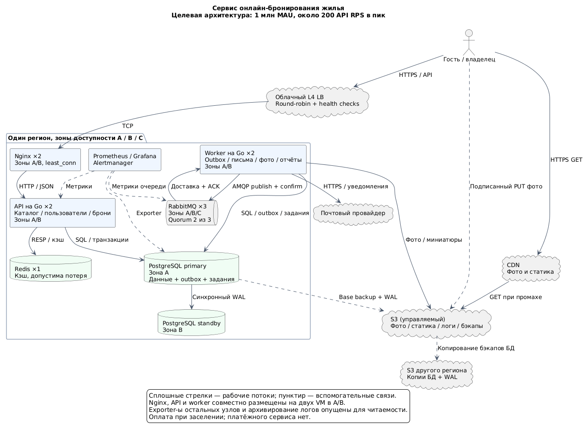

# Сервис онлайн-бронирования жилья

Расчётно-пояснительная записка к итоговому проекту по распределённым системам. РК1: архитектура и расчёты по пяти этапам.

## 1. Описание сервиса и аудитория

Сервис помогает найти и забронировать квартиру для короткой поездки. Пользователь выбирает город и даты, смотрит варианты и оформляет бронь. Владелец размещает объявление и управляет доступностью квартиры.

Для первой версии принимаются простые правила: одно объявление соответствует одной квартире, квартира сдаётся целиком, цена за ночь фиксирована. Оплата происходит при заселении. Внутри сервиса нет платежей, чатов, отзывов и интеграций с другими площадками. Владелец выделяет сервису свой календарь доступности; защита от пересечений действует только для броней внутри нашей системы.

### 1.1. Аналоги и актуальность

Близкие аналоги — [Суточно.ру](https://sutochno.ru/) и [Booking.com](https://www.booking.com/). Они позволяют искать жильё по датам и оформлять бронирования.

По [официальным результатам «Суточно.ру» за 2025 год](https://corp.sutochno.ru/tpost/56gl1n7n81-konsolidirovannie-finansovie-rezultati-s), на платформе было 391 тыс. объектов и более 151 тыс. хозяев; за год забронировано 13,8 млн ночей. В [отчёте Booking Holdings за 2024 год](https://www.sec.gov/Archives/edgar/data/1075531/000107553125000010/bkng-20241231.htm) указано 1 144 млн забронированных ночей по группе.

Проект рассчитан на 1 млн MAU. Для проверки порядка величин предположим, что доступная аудитория — 10 млн человек, ищущих жильё онлайн за месяц, и сервисом пользуются 10% из них: `10 млн × 10% = 1 млн MAU`.

Предполагаемое распределение пользователей: Россия — 90% (900 тыс.), Беларусь — 5% (50 тыс.), Казахстан — 5% (50 тыс.). Все квартиры MVP расположены в России. Пользователи из других стран могут бронировать их для поездок. Бэкенд размещается в одном регионе в России, в нескольких зонах доступности, фотографии раздаются через CDN.

### 1.2. Функции MVP

1. Поиск свободного жилья по городу, датам, цене и количеству гостей.
2. Просмотр карточки квартиры, фотографий и условий проживания.
3. Создание и отмена бронирования, уведомления по электронной почте.
4. Регистрация, вход и просмотр своих бронирований.
5. Кабинет владельца: изменение объявления, фотографий, цены и календаря.

### 1.3. Продуктовые метрики и допущения

Далее используются десятичные единицы: `1 КБ = 1 000 байт`, `1 ГБ = 10⁹ байт`, `1 ТБ = 10¹² байт`. Размеры записей и ответов приблизительные. Горизонт основных расчётов — 12 месяцев работы при заданной нагрузке.

| Показатель | Значение | Как получено |
| --- | ---: | --- |
| MAU | 1 000 000 | Целевая аудитория |
| DAU | 100 000 | Принимаем DAU/MAU = 10% |
| Дней активности на пользователя в месяц | 3 | `100 000 × 30 / 1 000 000` |
| Всего зарегистрированных аккаунтов | 1 500 000 | Включая неактивных в текущем месяце |
| Квартир в каталоге | 50 000 | Допущение о размере предложения |
| Бронирований в сутки | 2 000 | 2% дневной аудитории |
| Отмен в сутки | 400 | 20% от числа создаваемых броней, в среднем |
| Средняя длительность проживания | 3 ночи | Допущение |
| Бронирований за год | 730 000 | `2 000 × 365`, включая впоследствии отменённые |
| Ночей по неотменённым броням за год | 1 752 000 | `730 000 × 0,8 × 3` |

В среднем получается `1 752 000 / (50 000 × 365) ≈ 9,6%` занятых ночей от полного календаря каталога. Для небольшой площадки это допустимо: не все квартиры доступны круглый год и не каждый посетитель бронирует.

Действия считаются на одного активного пользователя за день. Дробное число означает среднее по всей DAU, включая гостей и владельцев.

| Тип запроса | Действий в день | Запросов в сутки | Средний ответ API без фотографий |
| --- | ---: | ---: | ---: |
| Поиск, одна страница до 20 результатов | 5 | 500 000 | 50 КБ |
| Просмотр карточки | 10 | 1 000 000 | 10 КБ |
| Создание брони | 0,02 | 2 000 | 2 КБ |
| Отмена брони | 0,004 | 400 | 1 КБ |
| Вход, профиль, список своих броней | 1 | 100 000 | 5 КБ |
| Изменения владельца | 0,05 | 5 000 | 2 КБ |
| **Итого** | **16,074** | **1 607 400** | — |

Средний объём данных в пересчёте на одного MAU показан ниже. Это деление общих данных на аудиторию.

| Тип данных | Количество на одного MAU | ГБ на одного MAU |
| --- | ---: | ---: |
| Аккаунты | 1,5 записи по 2 КБ | 0,000003 |
| Объявления | 0,05 записи по 4 КБ | 0,0000002 |
| Календарь на 365 дней | 18,25 записи по 100 байт | 0,000001825 |
| Брони за 12 месяцев | 0,73 записи по 2 КБ | 0,00000146 |
| Служебные данные | До 0,4 записи, в среднем по 0,5 КБ | 0,0000002 |
| Фотографии и миниатюры | 0,5 фото по 200 КБ и 0,5 миниатюры по 20 КБ | 0,00011 |
| **Итого постоянных данных** | — | **0,000116685** |

Кэш, очереди и технические логи считаются отдельно: они зависят от нагрузки и срока хранения.

## 2. Технические метрики и балансировка

### 2.1. RPS

`Средний RPS = запросов за сутки / 86 400`. Для вечеров и праздников принимается коэффициент пика 10. Пик не длится целые сутки.

| Запрос | Средний RPS | Пиковый RPS |
| --- | ---: | ---: |
| Поиск | 5,79 | 57,87 |
| Карточка | 11,57 | 115,74 |
| Создание брони | 0,023 | 0,231 |
| Отмена | 0,005 | 0,046 |
| Личный кабинет | 1,16 | 11,57 |
| Изменения владельца | 0,058 | 0,579 |
| **Итого API** | **18,60** | **186,04** |

Для проектирования округляем пик до **200 RPS**. При росте нагрузки в 1,5 раза — до **300 RPS**. Запросы фотографий не проходят через API и в эту таблицу не входят.

### 2.2. Трафик

Средний входящий API-запрос принимается равным 1 КБ. На одну страницу поиска загружаются 20 миниатюр по 20 КБ, на карточку — в среднем пять фото по 200 КБ. Изображения считаем без экономии от браузерного кэша. Ежедневно владельцы загружают или заменяют примерно 5 000 фотографий по 200 КБ, то есть 1 ГБ. Миниатюры создаются внутри системы.

`API-ответы = 500 000 × 50 КБ + 1 000 000 × 10 КБ + 2 000 × 2 КБ + 400 × 1 КБ + 100 000 × 5 КБ + 5 000 × 2 КБ = 35,5144 ГБ/сутки`.

`Изображения = 500 000 × 20 × 20 КБ + 1 000 000 × 5 × 200 КБ = 1 200 ГБ/сутки`.

| Трафик на внешней границе сервиса | Объём в сутки | Средняя скорость | Пиковая скорость, ×10 |
| --- | ---: | ---: | ---: |
| Входящий API | 1,6074 ГБ | 0,149 Мбит/с | 1,49 Мбит/с |
| Загрузка фото | 1 ГБ | 0,093 Мбит/с | 0,93 Мбит/с |
| **Входящий всего** | **2,6074 ГБ** | **0,241 Мбит/с** | **2,41 Мбит/с** |
| Исходящий API | 35,5144 ГБ | 3,29 Мбит/с | 32,88 Мбит/с |
| Исходящие изображения через CDN | 1 200 ГБ | 111,11 Мбит/с | 1 111,11 Мбит/с |
| **Исходящий всего** | **1,2355 ТБ** | **114,40 Мбит/с** | **1,144 Гбит/с** |

Формула скорости: `байт за сутки × 8 / 86 400`. За 30 дней получается около 37,1 ТБ исходящего трафика, из них 36 ТБ — изображения. Это существенная статья расходов даже при небольшом API RPS.

Изображения дают `500 000 × 20 + 1 000 000 × 5 = 15 млн` запросов в сутки: в среднем 174 RPS и около 1 736 RPS в пик. При попадании в CDN-кэш 90% запросов и байтов до S3 дойдёт около 174 RPS и 111 Мбит/с в пик. Это допущение нужно проверить после запуска. При холодном кэше S3 должен выдерживать весь поток. Целевой лимит CDN — от 3 Гбит/с и 4 000 RPS, включая рост и запас.

Расчёт выполнен по полезным данным. Для HTTP/TLS, статики сайта и небольших служебных запросов добавляем 20% запаса при выборе каналов. Внутренняя репликация, бэкапы и мониторинг не включены во внешний пользовательский трафик; для серверов закладывается сеть 1 Гбит/с.

### 2.3. Балансировка нагрузки

| Участок | Решение | Почему подходит; альтернатива |
| --- | --- | --- |
| Клиент → вход сервиса | Управляемый облачный L4-балансировщик, round-robin по TCP-соединениям | Единый адрес и исключение неисправной VM по проверке здоровья. Собственный keepalived потребовал бы настройки виртуального IP и переключения |
| Nginx → экземпляры API | Два Nginx, L7 reverse proxy, `least_conn` | Поиск бывает дольше чтения карточки, поэтому учитываем число активных запросов. Обычный round-robin тоже возможен, но хуже учитывает такую разницу |
| Клиент → изображения | CDN перед S3 | Большая часть трафика — фотографии. Раздача через API заняла бы его соединения и канал |

Облачный балансировщик проверяет `/healthz` Nginx каждые 5 секунд, исключает узел после трёх ошибок. В Nginx используются пассивные проверки upstream: `max_fails=3`, `fail_timeout=10s`. Активные проверки backend в бесплатном Nginx не предполагаются. Поддержку алгоритмов и пассивных проверок описывает [документация Nginx](https://nginx.org/en/docs/http/load_balancing.html).

Оба Nginx знают адреса обоих API. Сессии хранятся в PostgreSQL, поэтому привязка пользователя к экземпляру и `ip_hash` не нужны. TLS завершается на Nginx, внутренние соединения проходят в приватной сети; подключения к хранилищам шифруются. На входе задаются ограничение размера запроса и rate limit, например 10 запросов/с с burst 20 на IP; для авторизованных операций дополнительно действует лимит по аккаунту в API.

Глобальную балансировку и service mesh для одного региона не используем. Отдельный API Gateway пока не нужен: маршрутизация и ограничения помещаются в Nginx.

## 3. Системы хранения данных

### 3.1. Выбор хранилищ

| Данные | Хранилище | Обоснование и альтернатива |
| --- | --- | --- |
| Пользователи, сессии, объявления, календарь, брони | PostgreSQL | Связанные данные и транзакции. Создание брони должно атомарно проверять доступность. MongoDB не даёт здесь преимущества перед реляционной моделью |
| Outbox, ключи идемпотентности, результаты отправки, суточные отчёты | PostgreSQL | Их мало, а событие о брони нужно фиксировать в одной транзакции с бронью. Отдельная БД усложнит согласование |
| Карточки и результаты популярных поисков | Redis | Короткий TTL и быстрый доступ по ключу. Memcached тоже подходит, но Redis позволяет тем же клиентом хранить небольшие счётчики ограничений |
| Фотографии, миниатюры, резервные копии | Управляемое S3-совместимое хранилище, отдельные бакеты | Объекты удобно раздавать через CDN. Хранение фото в PostgreSQL увеличило бы базу и бэкапы |
| Очередь уведомлений и DLQ | RabbitMQ, quorum queues | Нужна очередь задач с подтверждением обработки. Kafka избыточна для нескольких тысяч событий в день и без длительного воспроизведения потока |
| Логи | JSON-файлы на VM, ротация, архив в S3 | При таком объёме можно начать без Elasticsearch/Loki. Минус — поиск по логам неудобнее |
| Метрики | Локальная TSDB Prometheus | Подходит для числовых временных рядов и алертов; хранить каждое измерение в PostgreSQL незачем |

Поиск сначала выполняется SQL-запросами по городу, цене, вместимости и датам. Для 50 тыс. объявлений начинаем с индексов PostgreSQL. Elasticsearch имеет смысл добавлять при появлении сложного текстового поиска или если нагрузочный тест покажет, что SQL не укладывается в задержки.

### 3.2. Модель данных и защита от двойного бронирования

Основные таблицы:

- `users(id, email, password_hash)` и `sessions(token_hash, user_id, expires_at)`;
- `listings(id, owner_id, city, price, capacity, description)`;
- `availability(listing_id, date, is_open)` с уникальным ключом `(listing_id, date)`;
- `bookings(id, user_id, listing_id, date_from, date_to, total_price, status)`;
- `outbox(id, booking_id, event_type, created_at, published_at)`;
- `idempotency(user_id, key, request_hash, result)` и `notification_results(event_id, status)`.

Ссылки и ключи фотографий находятся в метаданных объявления; бинарные файлы — в S3. Цена в брони фиксируется при создании, денежные значения хранятся целым числом копеек. Пароли хранятся только как хеши с солью, сессия — в защищённой cookie, в БД хранится хеш токена.

Простой способ сериализовать изменения: при создании/отмене брони, изменении цены или календаря сначала брать `SELECT ... FOR UPDATE` на строке квартиры. Затем внутри одной короткой транзакции проверять владельца/пользователя, даты, открытые дни и пересечения. Сетевые вызовы в эту транзакцию не входят. Отмена и блокировка календаря также соблюдают этот порядок; владелец не может закрыть даты уже подтверждённой брони.

Дополнительная защита на стороне PostgreSQL — ограничение на пересечение диапазонов для подтверждённых броней. Пример для уже созданной таблицы:

```sql
CREATE EXTENSION IF NOT EXISTS btree_gist;

ALTER TABLE bookings
    ADD CONSTRAINT valid_dates CHECK (date_from < date_to),
    ADD CONSTRAINT no_overlapping_bookings
    EXCLUDE USING gist (
        listing_id WITH =,
        daterange(date_from, date_to, '[)') WITH &&
    ) WHERE (status = 'confirmed');
```

Дата выезда не включена в диапазон: один гость может выехать в день заезда другого. Такой механизм предусмотрен [типами диапазонов и exclusion constraints PostgreSQL](https://www.postgresql.org/docs/current/rangetypes.html). Статусы MVP — `confirmed` и `cancelled`, отдельного ожидания оплаты нет.

При конфликте API возвращает 409. Даже если поиск показал устаревшее свободное жильё, финальная проверка идёт на primary в транзакции. Redis не используется как блокировка и не определяет возможность бронирования.

### 3.3. Объём постоянных данных

| Данные | Количество | Размер единицы | Объём, ТБ |
| --- | ---: | ---: | ---: |
| Аккаунты | 1 500 000 | 2 КБ | 0,003 |
| Объявления, включая метаданные фото | 50 000 | 4 КБ | 0,0002 |
| Календарь на год вперёд | `50 000 × 365 = 18 250 000` | 100 байт | 0,001825 |
| Брони за 12 месяцев | 730 000 | 2 КБ | 0,00146 |
| Служебные записи | До 400 000 | В среднем 0,5 КБ | 0,0002 |
| **PostgreSQL, полезные данные** | **Около 20,93 млн записей** | — | **0,006685** |
| Фото | `50 000 × 10 = 500 000` | 200 КБ | 0,1 |
| Миниатюры | 500 000 | 20 КБ | 0,01 |
| **S3, изображения** | **1 000 000 объектов** | — | **0,11** |

Служебный резерв включает примерно 150 тыс. сессий, по 72 тыс. outbox-событий, ключей идемпотентности и результатов уведомлений за 30 дней, а также небольшие отчёты. Сессии и ключи имеют TTL до 30 дней; старые обработанные события удаляются. Неотправленные события автоматически не удаляем. История завершённых броней хранится 12 месяцев, старые записи удаляются ежедневной задачей. Таблица показывает накопление за первый год; дополнительные будущие брони учитываются в запасе на рост. Для реального продукта сроки хранения нужно согласовать отдельно.

Календарь — скользящее окно 365 дней. Ежедневно добавляются 50 тыс. новых записей и удаляются прошедшие дни. Изображения нормализуются до принятого размера; исходные большие файлы после обработки удаляются. Предполагаем рост аудитории и каталога на 50% на следующий год.

| Система | Расчёт с учётом накладных расходов, роста и копий | Требуемый объём |
| --- | --- | ---: |
| PostgreSQL | `0,006685 × 2` на индексы и служебное место, `× 1,5` рост, `× 2` primary + standby | 0,04011 ТБ суммарно; выделяем 2 × 0,1 ТБ |
| S3, изображения | `0,11 × 1,5`, плюс 30% на старые версии | 0,2145 ТБ пользовательского объёма; квота 0,25 ТБ |
| Redis | 50 тыс. карточек × 10 КБ + 5 тыс. поисков × 50 КБ = 0,75 ГБ; `× 2` на структуры и `× 1,5` рост | 0,00225 ТБ RAM; `maxmemory = 4 ГБ` |
| RabbitMQ | Запас 100 тыс. событий по 1 КБ; `× 3` на служебные данные, `× 1,5` рост, `× 3` реплики | 0,00135 ТБ суммарно; диски 3 × 0,02 ТБ |
| Логи | `1 607 400 × 0,5 КБ × 14 дней = 11,25 ГБ`; `× 1,5` рост и `× 2` на служебные логи | 0,0338 ТБ; резерв 0,05 ТБ в S3 |
| Prometheus | 50 тыс. рядов, 15 секунд между измерениями, 15 дней, около 2 байт/точку; `× 3` на WAL/индексы и `× 1,5` рост | Около 0,039 ТБ; резерв 0,1 ТБ локально |
| Резервные копии PostgreSQL | Пять недельных полных копий по 20,055 ГБ + до 2 ГБ WAL/сутки за 30 дней | Около 0,161 ТБ; резерв 0,2 ТБ в отдельном бакете |

Для управляемого S3 внутреннее число физических копий зависит от провайдера. Указан оплачиваемый логический объём, повторно умножать его на репликацию нельзя. Выбирается тариф с хранением в нескольких зонах. Общий бюджет S3 — около 0,5 ТБ: изображения, логи и бэкапы. Копирование бэкапов в другой регион создаст ещё до 0,2 ТБ и отдельный трафик.

Для логов CDN отдельное полное журналирование 15 млн запросов в сутки не включаем: используем агрегированные метрики провайдера.

### 3.4. Настройка и эксплуатация хранилищ

| Система | Наблюдаемость | Надёжность и обслуживание | Масштабирование |
| --- | --- | --- | --- |
| PostgreSQL | Длительность запросов, блокировки, активные соединения, lag реплики, WAL, свободный диск; postgres_exporter и `pg_stat_statements` | Primary + синхронный standby в другой зоне, `synchronous_commit=on`; недельный base backup и непрерывная архивация WAL; autovacuum включён | Сначала индексы и больше RAM, затем чтение каталога с реплики. Календарь можно разбить по месяцам. Шардирование пока не требуется |
| Redis | Hit rate, evictions, память, latency через redis_exporter | Один экземпляр, TTL поиска 30 с, карточки 5 мин, `allkeys-lru`; бэкапы не нужны, кэш восстанавливается из БД | Увеличить RAM; Redis Cluster только при нехватке одного узла |
| S3 | 4xx/5xx, latency GET/PUT, объём, CDN hit rate | Версионирование, lifecycle для старых версий 30 дней; бакет бэкапов доступен отдельной учётной записи | Масштабирование на стороне провайдера; увеличивать квоты запросов и объёма |
| RabbitMQ | Глубина очереди, возраст старейшего сообщения, unacked, свободный диск, состояние участников | Три узла в разных зонах, quorum 2 из 3; publisher confirms и ручной ACK; события остаются в outbox 30 дней | Добавлять consumers; при необходимости разделить очереди по типу задач |
| Логи и Prometheus | Успех сбора, занятое место, пропуски scrape, свежесть архивов | Логи локально за 2 дня, архивы в S3 за 14 дней; метрики за 15 дней; конфиги мониторинга в Git | Ограничивать число рядов и объём логов; центральный сбор добавить при росте |

Политика вытеснения Redis описана в [документации](https://redis.io/docs/latest/develop/reference/eviction/). Счётчики лимитов в Redis вспомогательные: их потеря не влияет на целостность бронирований. Базовый лимит Nginx продолжает действовать.

Все запросы бронирования и чтение своих броней идут на primary. Синхронная реплика нужна прежде всего для сохранности подтверждённых изменений. При её потере запись приостанавливается до восстановления репликации либо безопасного переключения; автоматического перехода на асинхронную запись нет. Это сознательный обмен доступности на сохранность данных, основанный на [механизме synchronous replication PostgreSQL](https://www.postgresql.org/docs/current/warm-standby.html).

## 4. Программные инструменты и аппаратное обеспечение

### 4.1. Компоненты и схема

Основная логика — модульный монолит: каталог, пользователи и бронирования находятся в одном приложении. Запускаются два одинаковых экземпляра. Отдельный worker выполняет фоновые задания. При расчётных 200 RPS разделять каждый модуль в отдельный микросервис пока нет необходимости.



Исходник: [PlantUML](docs/architecture.puml). На схеме показана целевая архитектура, а не уже развёрнутая инфраструктура. Узлы A/B/C означают зоны доступности одного региона.

| Компонент | Язык/runtime и библиотеки | Роль и обоснование |
| --- | --- | --- |
| Веб-клиент | HTML/CSS, небольшой JavaScript, браузер | Формы поиска и бронирования, запросы REST API. Статика размещается в S3/CDN; отдельный сервер рендеринга не требуется |
| API, 2 экземпляра | Go, `net/http`, маршрутизатор chi, `pgx`, `go-redis`, `encoding/json` | Go удобен для множества запросов, ожидающих БД и сеть. Небольшой HTTP-стек и явные SQL-запросы позволяют контролировать транзакции |
| Worker, 2 экземпляра | Go, `pgx`, `amqp091-go`, стандартные библиотеки обработки изображений | Один стек с API; отправка событий, уведомления, подготовка миниатюр, периодические задания |
| Reverse proxy | Готовый Nginx | TLS, лимиты и маршрутизация; собственный прокси не пишем |
| Хранилища, брокер, мониторинг | Готовые PostgreSQL, Redis, RabbitMQ, Prometheus и Grafana | Используются штатные runtime и контейнеры; прикладного кода для них нет |

В Go есть сборщик мусора: большое количество временных объектов может увеличивать CPU и задержки. Поэтому ограничиваем страницу поиска 20 результатами, избегаем загрузки всего каталога в память и используем пулы соединений. JSON проще отлаживать, чем Protobuf; при наших размерах ответов его стоимость допустима как начальное предположение. `net/http` обеспечивает HTTP keep-alive и отмену по context. Затраты GC проверяем по метрикам и профилям; ориентир — [руководство Go по GC](https://go.dev/doc/gc-guide).

Альтернатива — Python/FastAPI: для такой нагрузки он тоже возможен, но для параллельной обработки изображений потребуются отдельные процессы. Java/Spring также подходит, но для небольшого приложения не требуется его более крупный стек. Выбор Go не заменяет измерения производительности.

### 4.2. Ресурсы

Это стартовые оценки для нагрузки до 300 RPS, а не результат бенчмарка. Используются обычные x86-64 vCPU и RAM класса DDR4/DDR5; GPU не нужны. SSD выбираются ради коротких случайных чтений и записи WAL. Выделенный локальный NVMe при текущей нагрузке необязателен: важнее устойчивые задержки и сохранность диска.

| Компонент | Количество | CPU / RAM на экземпляр | Диск на экземпляр | Сеть и комментарий |
| --- | ---: | --- | --- | --- |
| Nginx | 2 | 1 vCPU / 1 ГБ | Общий диск VM приложения | 1 Гбит/с; фотографии идут через CDN |
| API | 2 | 2 vCPU / 4 ГБ | Общий диск VM приложения | 1 Гбит/с; до 30 соединений с PostgreSQL на экземпляр |
| Worker | 2 | 1 vCPU / 2 ГБ | Общий диск VM приложения | 1 Гбит/с; до 5 соединений с БД, обработка фото с ограничением параллелизма |
| PostgreSQL | 2 | 4 vCPU / 16 ГБ | 100 ГБ SSD, от 3 000 IOPS и 100 МБ/с | 1 Гбит/с; желаемая RTT между зонами до 5 мс |
| Redis | 1 | 2 vCPU / 8 ГБ | 40 ГБ SSD для ОС | 1 Гбит/с; данные кэша в RAM |
| RabbitMQ | 3 | 1 vCPU / 2 ГБ | 20 ГБ SSD, от 500 IOPS | 1 Гбит/с; запас прежде всего для отказоустойчивости |
| Prometheus + Grafana + Alertmanager | 1 | 4 vCPU / 8 ГБ | 200 ГБ SSD, от 1 000 IOPS | 1 Гбит/с; мониторинг не в пути пользовательского запроса |
| L4 LB, S3 и CDN | Управляемые сервисы | Ресурсы выделяет провайдер | S3: около 0,5 ТБ + внешние бэкапы | LB: от 1 000 API RPS; CDN: от 3 Гбит/с и 4 000 RPS |

Nginx, API и worker совместно размещаются на двух VM по 4 vCPU, 8 ГБ RAM и 40 ГБ SSD, по одной в зонах A и B. Их ресурсы в таблице — доли этих VM, повторно складывать их с VM не нужно. PostgreSQL размещён в A/B; RabbitMQ — в A/B/C. Redis и мониторинг — на отдельных VM.

Всего получается **9 VM, 25 vCPU, 70 ГБ RAM и 580 ГБ локальных дисков**, без управляемых сервисов и резервного региона. Большая часть экземпляров нужна для переживания отказов, а не из-за высокого среднего RPS. Для учебного локального стенда все компоненты можно поднять на одном компьютере без этой избыточности.

При гипотезе 5 мс CPU на API-запрос один экземпляр на 200 RPS использует `200 × 0,005 = 1` ядро из двух. Это оставляет запас, но гипотезу нужно проверить. Цель теста — один оставшийся API выдерживает текущий пик 200 RPS; перед ростом до 300 RPS добавляется третья VM приложения либо увеличиваются ресурсы. Медленный SQL может стать ограничением раньше CPU приложения.

Диски расширяются при заполнении 70%. API масштабируется при CPU выше 60% в течение 15 минут или устойчивом нарушении p95. Для PostgreSQL сначала проверяем планы запросов и блокировки. При примерно 6,7 ГБ полезных данных преждевременное шардирование усложнит бронирование без явной выгоды.

### 4.3. Тестирование, контейнеризация и деплой

- Unit-тесты: стандартный `testing` в Go — расчёт стоимости, проверка дат, права на отмену.
- Integration-тесты: Docker Compose с настоящими PostgreSQL, Redis и RabbitMQ. Главные проверки: две одновременные брони одной квартиры, повтор одного ключа идемпотентности, отмена одновременно с новой бронью, падение брокера после коммита в БД.
- Нагрузочные тесты: k6 с рассчитанным соотношением запросов; этапы 20 → 200 → 300 RPS. Отдельно прогон без Redis и с отключением одного API. Для БД предварительно загружается каталог и календарь расчётного размера.
- Docker используется для одинакового окружения. На VM достаточно Docker Compose и systemd для запуска после перезагрузки. Kubernetes при девяти VM и небольшом числе приложений добавил бы обслуживание control plane, поэтому в MVP его нет.
- Простой CI/CD: GitHub Actions запускает тесты, собирает образ и помещает его в GHCR. Деплой по одному экземпляру с проверкой здоровья; откат — на предыдущий тег. Миграции сначала должны быть совместимы с обеими версиями API.

## 5. Взаимодействие компонентов

### 5.1. Протоколы

| Кто с кем взаимодействует | Тип и инструмент | Почему |
| --- | --- | --- |
| Браузер → LB → Nginx → API | Синхронно, HTTPS, REST/JSON | Нужен немедленный ответ на поиск и создание брони. REST достаточно для нескольких простых ресурсов; GraphQL не требуется |
| Браузер → CDN → S3 | Синхронно, HTTPS GET | Изображения и статика не занимают API. CDN обращается в S3 только при промахе кэша |
| API → PostgreSQL | Синхронно, PostgreSQL protocol через pgx | Транзакции и проверка ограничений до ответа пользователю |
| API → Redis | Синхронно, RESP | Быстрое чтение кэша; при ошибке запрос ограниченно направляется в БД |
| Владелец → S3 | HTTPS PUT по короткой подписанной ссылке, полученной через API | API проверяет право на объявление, а файл передаётся напрямую. Завершение загрузки подтверждается отдельным запросом API |
| Worker → S3 | Фоновый HTTPS GET/PUT | Проверка изображения и создание миниатюры. Публикуется только обработанное фото; временные загрузки удаляются через сутки |
| PostgreSQL outbox → worker → RabbitMQ | Асинхронно, опрос SQL раз в секунду, публикация AMQP | Событие не теряется между коммитом брони и отправкой в брокер |
| RabbitMQ → worker → почтовый провайдер | Асинхронно, AMQP и HTTPS API провайдера | Задержка письма не должна задерживать создание брони |
| Worker → PostgreSQL | Фоновые SQL-транзакции | Результаты обработки, очистка и суточные агрегаты |
| PostgreSQL primary → standby | Потоковая синхронная репликация WAL | Резервная копия подтверждённых транзакций на другом узле |
| Backup-задача → S3 другого региона | Фоновая передача по HTTPS | Восстановление при потере основного региона |
| Exporters и приложения → Prometheus | HTTP scrape, каждые 15 с | Единый сбор метрик; системные показатели через node_exporter |
| Grafana → Prometheus; Alertmanager → дежурный | HTTP API и уведомления | Просмотр графиков и доставка алертов |
| Архиватор логов → S3 | Фоновый HTTPS PUT каждый час | Простое хранение логов без отдельного поискового кластера |

Внутри монолита модули вызывают обычные функции. gRPC между ними не нужен. Брокер используется для уведомлений; задания обработки фото можно хранить в PostgreSQL и выбирать worker-ом, не строя второй поток сообщений.

### 5.2. Транзакции и гарантии доставки

Создание брони проходит так:

1. Клиент передаёт `Idempotency-Key`. API проверяет сессию и ищет результат предыдущего запроса по `(user_id, key)`.
2. В транзакции фиксируется ключ, блокируется строка квартиры, проверяются доступные даты и создаётся бронь. В той же транзакции добавляется событие в `outbox` и сохраняется результат запроса. Уникальный индекс на ключе защищает от одновременных повторов.
3. После успешного коммита API отвечает пользователю. При сетевом обрыве клиент повторяет запрос с прежним ключом и получает существующую бронь. Тот же ключ с другим телом запроса даёт 409.
4. Worker выбирает события пакетами, несколько worker-ов разделяют их через `FOR UPDATE SKIP LOCKED` и короткую аренду записи. Публикует событие и после publisher confirm помечает его отправленным. Просроченная аренда позволяет повторить работу после падения.
5. Consumer подтверждает сообщение только после обработки. Результат записывается по уникальному `event_id`. Письмо содержит состояние и ссылку на актуальную бронь; порядок доставки писем не гарантируется.

Гарантия — **at-least-once**: если процесс упал после публикации, но до отметки в outbox, событие придёт повторно. Дедупликация защищает повторяемые изменения внутри БД. Для почтового провайдера передаём `event_id` как ключ идемпотентности, если он это поддерживает. Без такой поддержки письмо иногда может отправиться дважды: exactly-once для внешней отправки не обещаем.

RabbitMQ использует quorum queues с большинством 2 из 3. Механизм описан в [документации quorum queues](https://www.rabbitmq.com/docs/quorum-queues), подтверждения — в [Consumer Acknowledgements and Publisher Confirms](https://www.rabbitmq.com/docs/confirms). При недоступности брокера новые брони продолжают фиксироваться, события ожидают в outbox.

### 5.3. Таймауты, повторы и наблюдаемость

| Операция | Ограничение |
| --- | --- |
| Redis | Таймаут 50 мс, без повторов в пользовательском запросе |
| SQL поиска | `statement_timeout = 700 мс` |
| Транзакция бронирования | Дедлайн 2 с, `lock_timeout = 300 мс`; при конфликте блокировок клиент получает возможность повторить запрос |
| Весь API-запрос | Дедлайн приложения 3 с, таймаут reverse proxy 4 с |
| Почтовый провайдер | Таймаут 5 с; повтор через 10 с, 1 мин и 10 мин с небольшим случайным сдвигом |
| Необработанное сообщение | После трёх повторов — DLQ, алерт, повторный запуск после исправления |

Повтор небезопасного POST на прокси отключён. Для создания/отмены брони повторяет клиент с тем же ключом. Retry не должен начинаться заново на каждом сетевом слое. Для временной ошибки публикации worker повторяет с увеличением паузы до 60 с; событие остаётся в outbox.

Перенос в DLQ и отложенные очереди выполняется с publisher confirm перед ACK исходного сообщения. При сбое возможен дубль, но исходное сообщение не подтверждается до сохранения следующей копии. DLQ проверяется оператором, бесконечного `requeue` нет.

В логах передаются `request_id`, `booking_id` и `event_id`, длительность и код результата. Тела запросов, пароли и токены не логируются. Эти идентификаторы не становятся метками Prometheus, чтобы не создавать миллионы временных рядов. Для синхронных вызовов измеряются RPS, ошибки и latency; для асинхронных — возраст события, глубина очереди, повторы и DLQ.

## 6. Обработка данных

Для MVP не нужны AI/ML, потоковый движок и отдельное аналитическое хранилище. Поиск строится по явным фильтрам, рекомендации отсутствуют. Нужны следующие небольшие фоновые процессы:

| Задача | Инструмент и режим | Ресурсы и обоснование |
| --- | --- | --- |
| Создание миниатюр и проверка фото | Go worker, библиотека `image`, задания в PostgreSQL | До 1 vCPU и 1 ГБ RAM внутри лимита worker; 5 тыс. фото/сутки — около 0,058 задания/с. Ограничиваем файл 10 МБ и 20 мегапикселями, декодируем по одному на worker |
| Отправка уведомлений | Go worker + RabbitMQ | До 0,5 vCPU и 512 МБ RAM из того же лимита; примерно 2 400 событий/сутки. Ожидание провайдера выполняется с ограниченным параллелизмом |
| Очистка сессий, ключей, старых броней и обновление календаря | Ежедневное задание worker, SQL пакетами | До 0,5 vCPU и 256 МБ RAM; небольшие пакеты уменьшают время блокировок |
| Суточный отчёт по броням, отменам и городам | SQL `GROUP BY` и таблица `daily_stats` | До 1 vCPU и 256 МБ RAM на время расчёта; обрабатывается один день, примерно 2 тыс. новых броней |

Ресурсы задач делят два worker-а из таблицы оборудования, отдельные серверы для каждой задачи не выделяются. Периодические задания запускаются ночью последовательно. На время отчёта обработка фото ограничивается. Для календаря действует скользящий горизонт, а результаты отчёта перезаписываются по уникальному ключу `(date, city)`.

Два экземпляра worker могут увидеть одно расписание: лидер задания выбирается advisory lock в PostgreSQL на выделенном соединении. При разрыве соединения выполнение прекращается. Последняя успешно обработанная дата хранится в БД, поэтому после простоя пропущенный день обрабатывается повторно. Очистка и добавление календаря идемпотентны.

Airflow удобен для множества зависимых ETL-задач, но здесь достаточно таймера worker и SQL. Kafka Streams/Flink не нужны: нет большого потока, требующего обработки в реальном времени. ClickHouse можно добавить позже для подробной аналитики поведения; сейчас суточные агрегаты помещаются в PostgreSQL.

## 7. Обеспечение надёжности

### 7.1. Цели и ограничения

Пользовательский SLO доступности — **99,9% за месяц**, то есть примерно 43 минуты недоступности за 30 дней. Успешным считается технически корректно обработанный запрос; ожидаемые отказы вроде занятой квартиры не являются сбоем. Ошибки 5xx, таймауты и отказы 429 из-за нехватки мощности считаются неуспехом. Тестируем доступность внешними синтетическими запросами и считаем долю успешных реальных запросов. Цели ниже нужно подтвердить испытаниями.

| Компонент / операция | Доступность | p50 / p95 / p99 | RTO | RPO |
| --- | --- | --- | --- | --- |
| LB + Nginx | 99,95% | Добавленная задержка 5 / 20 / 50 мс | До 1 мин на исключение узла | Нет постоянных данных |
| API поиска и карточек | 99,9% | 100 / 500 / 1 000 мс | До 5 мин при потере процесса | Нет локальных данных |
| API бронирования и кабинет | 99,9% | 150 / 800 / 2 000 мс | До 15 мин, если переключается БД | 0 для подтверждённых записей при отказе одного узла БД |
| PostgreSQL | 99,95% | Обычный SQL: 10 / 100 / 500 мс | До 15 мин при отказе узла | 0 для подтверждённых транзакций при сохранности синхронной пары |
| Redis | 99,5% | 1 / 5 / 20 мс | До 30 мин | Потеря всего кэша допустима |
| S3 + CDN | 99,9% | TTFB 50 / 200 / 500 мс | До 1 ч на обход неисправного CDN | Для удаления фото — восстановление версий за последние 30 дней |
| RabbitMQ | 99,9% | Подтверждение публикации 10 / 50 / 200 мс | До 5 мин при потере одного узла | 0 подтверждённых сообщений при сохранности большинства |
| Worker уведомлений | 99% событий переданы провайдеру за 5 мин | Время события до приёма провайдером: 5 / 60 / 300 с | До 1 ч | Повтор из outbox; при полной потере брокера — за последние 30 дней |
| Ночные задания | 99% запусков завершены до 06:00 МСК | До 5 / 15 / 30 мин | До 24 ч | 24 ч для отчёта, он пересчитывается |
| Prometheus / логи | 99% успешных сборов | Задержка метрик до 30 с, архив логов до 1 ч | До 4 ч | До 15 дней локальных метрик; до 1 ч неархивированных логов при потере VM |

RTO — допустимое время восстановления, RPO — допустимая потеря последних данных. Показатели отдельных компонентов не складываются в гарантию сервиса автоматически. Например, совместный бюджет простоев API и PostgreSQL должен уложиться в общий месячный бюджет; повторяющиеся переключения по 15 минут его быстро исчерпают.

Задержки API измеряются на входе Nginx; CDN — синтетическими запросами из целевых стран. Задержка полного открытия страницы зависит также от сети пользователя. Для потери всего региона цель слабее: **RTO до 24 часов, RPO до 15 минут** для БД, если WAL успешно скопирован в другой регион. Второго работающего региона нет, такое происшествие нарушит месячный SLO. Для фотографий при потере региона RPO не гарантируется: отдельная межрегиональная копия медиатеки в MVP не заложена.

### 7.2. Мониторинг и алерты

Используются Prometheus, Grafana и Alertmanager. Exporter-ы располагаются рядом с соответствующими процессами, node_exporter — на каждой VM. Дополнительно внешний uptime-check раз в минуту проверяет сайт и страницу поиска: локальный Prometheus не сможет сам сообщить о полной потере своего региона.

| Точка сбора | Метрики | Пример алерта |
| --- | --- | --- |
| Nginx и API `/metrics` | RPS, 5xx, таймауты, гистограммы latency, CPU, RAM | Ошибки >1% за 5 мин; p95 поиска >500 мс за 10 мин |
| PostgreSQL exporter | Lag, число соединений, блокировки, диск, состояние standby | Нет синхронной реплики; соединений >80% лимита; диск >70% |
| Redis exporter | Память, hit rate, evictions, время ответа | Hit rate <70% за 15 мин или резкий рост evictions |
| RabbitMQ plugin + worker | Queue depth, oldest event, unacked, retry, DLQ | Старейшее событие >5 мин; DLQ непустая; потеря кворума |
| S3/CDN API провайдера | Ошибки, hit rate, трафик, успешность PUT | 5xx >1%; падение CDN hit rate ниже 80% |
| Backup-задача и периодические задания | Время последнего успеха, длительность, число ошибок | Нет полного бэкапа >8 дней; внешний WAL старше 15 мин; ночная задача не завершилась к 06:00 |
| Prometheus и внешний uptime-check | Доступность целей, пропуски измерений | Цель недоступна >1 мин; пропал сам мониторинг |

Пороговые значения начальные. После запуска их нужно настроить по реальному профилю, чтобы не получать постоянные ложные тревоги. Панель по броням отдельно показывает число успешных созданий и конфликтов: всплеск 409 может означать популярную квартиру, а не отказ инфраструктуры.

### 7.3. Консистентность, репликация и восстановление

Бронирование требует согласованного решения по конкретной квартире. Оно обеспечивается транзакцией, блокировкой строки и ограничением пересечений. Для каталога и поиска допустима eventual consistency: изменение может стать видно через 30 секунд или 5 минут в зависимости от кэша. После изменения объявления API удаляет соответствующие ключи; TTL ограничивает устаревание при неудачной инвалидации.

При отказе PostgreSQL primary переключение выполняется оператором: проверить standby, остановить или изолировать старый primary, повысить standby до primary, изменить адрес подключения и перезапустить пулы API/worker. Старый узел возвращается только как реплика. Без уверенного отключения старого primary переключение запрещено, чтобы не получить два независимых источника записи. RTO 15 минут предполагает доступного дежурного; автоматизация failover в MVP не проработана.

Полная копия БД создаётся раз в неделю; WAL архивируется непрерывно, `archive_timeout` — 60 секунд. Копия в другом регионе и контроль свежести нужны для заявленного аварийного RPO. Храним пять последних полных копий и WAL за 30 дней; окно восстановления начинается с самой ранней полной копии, для которой сохранился весь нужный WAL. Доступ на удаление бэкапов отделён от приложения. Раз в месяц выполняется восстановление на отдельную VM и проверка количества броней, ограничений и возможности открыть личный кабинет. Реплика не заменяет бэкап: ошибочное удаление данных попадёт и на неё.

В S3 включено версионирование фотографий и очистка старых версий через 30 дней. Это помогает после случайной перезаписи, но не является отдельной региональной копией. Redis восстанавливается прогревом по запросам. При полной потере RabbitMQ события переотправляются из outbox с проверкой результатов обработки; история старше 30 дней для этого не сохраняется.

### 7.4. Деградация и ограничение ущерба

| Отказ | Поведение сервиса |
| --- | --- |
| Один Nginx/API или VM приложения | LB и Nginx исключают неисправный узел; второй принимает текущий пик. Worker-задачи подхватываются после истечения аренды |
| Redis | Поиск и карточки читаются из PostgreSQL с ограничением нагрузки. При перегрузке сначала отклоняются лишние поисковые запросы; бронирование сохраняет приоритет |
| PostgreSQL или синхронный standby | Новые брони временно недоступны. Можно показывать закэшированные карточки, но доступность дат обозначается как неподтверждённая |
| RabbitMQ | Брони сохраняются; уведомления ждут в outbox. При восстановлении worker разбирает накопившиеся события |
| Почтовый провайдер | Бронь видна в кабинете, письмо повторяется позже; пользовательский запрос не ждёт почту |
| S3 | API работает с метаданными, закэшированные фото остаются в CDN. Для отсутствующих фото показывается заглушка, загрузка новых временно отключается |
| CDN | API остаётся доступен по своему домену. Возможна ручная смена домена статики на резервный origin при достаточной квоте S3; мгновенное переключение не обещается |
| Worker или ночное задание | Второй worker подхватывает задачи; при полном простое отчёты устаревают, новые брони остаются доступны |
| Prometheus | Пользовательские запросы продолжаются; внешний монитор сообщает об отказе, метрики за время простоя теряются |

Для ограничения ущерба используем отдельные лимиты конкурентности поиска и бронирования. Из 30 соединений каждого API с БД 20 выделяются чтению каталога, 10 — кабинету и бронированию. Worker использует отдельный пул. Это не даёт долгому поиску занять все соединения.

Для Redis и почтового провайдера применяется простой circuit breaker: после пяти последовательных технических ошибок вызовы прекращаются на 30 секунд, затем разрешается пробный запрос. Для Redis используется чтение БД, для почты — ожидание и retry. Холодный кэш прогревается постепенно; одинаковые одновременные промахи внутри API объединяются. Массовая загрузка всего каталога после перезапуска не запускается.

При заполнении outbox или диска на 70% приходит алерт. Сначала отключаются второстепенные задания и увеличивается место; если сохранить бронь и её событие атомарно уже нельзя, операция отклоняется целиком. Молча терять событие ради успешного ответа не предполагается.

### 7.5. Работа с инцидентами

1. Дежурный получает алерт, проверяет влияние на поиск и создание броней, фиксирует время начала.
2. Сначала восстанавливает работу: откат релиза, исключение неисправного узла, отключение тяжёлого поиска или безопасное переключение БД.
3. Проверяет новые и последние подтверждённые брони, очередь уведомлений и отсутствие пересечений дат. Восстановление подтверждается метриками и пробным пользовательским сценарием.
4. После инцидента записывает причину, длительность, последствия и одну-две конкретные меры против повторения. Разбор проводится без поиска виноватого.

## 8. Источники

Внешние источники подтверждают рыночный контекст и свойства технологий. Числа нашей нагрузки, размеры записей, ресурсы и SLO — допущения проекта. Дата обращения: 16.11.2026.

1. [Суточно.ру — результаты за 2025 год](https://corp.sutochno.ru/tpost/56gl1n7n81-konsolidirovannie-finansovie-rezultati-s): объекты, хозяева и забронированные ночи.
2. [Booking Holdings — Annual Report 2024](https://www.sec.gov/Archives/edgar/data/1075531/000107553125000010/bkng-20241231.htm): масштаб онлайн-бронирования, данные по группе компаний.
3. [Nginx — HTTP load balancing](https://nginx.org/en/docs/http/load_balancing.html): least connections и пассивные проверки.
4. [PostgreSQL — Range Types](https://www.postgresql.org/docs/current/rangetypes.html): диапазоны дат и запрет пересечений.
5. [PostgreSQL — Log-Shipping Standby Servers](https://www.postgresql.org/docs/current/warm-standby.html): потоковая и синхронная репликация.
6. [Redis — Key eviction](https://redis.io/docs/latest/develop/reference/eviction/): maxmemory и политика вытеснения.
7. [RabbitMQ — Quorum Queues](https://www.rabbitmq.com/docs/quorum-queues): реплицированная очередь и большинство.
8. [RabbitMQ — Consumer Acknowledgements and Publisher Confirms](https://www.rabbitmq.com/docs/confirms): подтверждения доставки и обработки.
9. [Go — A Guide to the Go Garbage Collector](https://go.dev/doc/gc-guide): влияние аллокаций и сборки мусора.
10. [PlantUML — Smetana](https://plantuml.com/smetana02): локальное построение архитектурной диаграммы без внешнего Graphviz.
